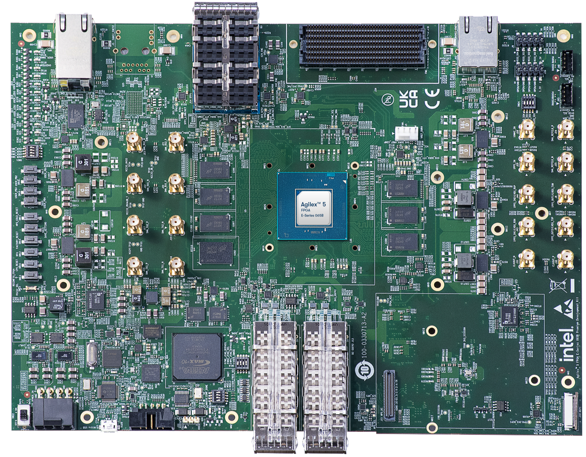

# Agilex 5 E-Series Data Movement Hardware Reference Designs

This repository contains Data Movement Hardware Reference Designs for Agilex 5 E-Series System On Chip (SoC) FPGA.
These designs showcase data transactions among FPGA fabric, Hard Processor System (HPS), and external memory, including benchmarking of fabric/HPS/EMIF data paths.
Refer to the [Data Mover User Guide](https://altera-fpga.github.io/latest/embedded-designs/agilex-5/e-series/premium-065a/data-mover/ug-data-mover-agx5e-premium-065a/) and the [Cache Coherent Accelerator Guide](https://altera-fpga.github.io/latest/embedded-designs/agilex-5/e-series/premium/gsrd/ug-gsrd-agx5e-premium/) for more information.

The [designs](#designs) are stored in individual folders. Each design can be opened, modified and compiled by using Quartus Prime software.
Repository releases are tagged for each version of Quartus Prime Software. It is recommended to use the release for your version of Quartus Prime.
These designs demonstrate system integration between the HPS and FPGA IPs for high-throughput data movement.

## Baseline feature
This is applicable to all designs.
- Hard Processor System (HPS) enablement and configuration
  - Enable dual core Arm Cortex-A76 processor
  - Enable dual core Arm Cortex-A55 processor
  - HPS Peripheral and I/O. eg, NAND, SD/MMC, EMAC, USB, SPI, I2C, UART, and GPIO. (depends on the daughter card).
  - HPS Clock and Reset
  - HPS FPGA Bridge and Interrupt
    - Note: The System MMU port in F2H bridge is enabled by default in data movement designs, unless otherwise specified.
- HPS EMIF configuration (ECC enabled)

## Advanced feature
This is only applicable if the feature is enabled.
- Data Mover: mSGDMA-based fabric/HPS/EMIF data-path benchmarking (F2H, F2SDRAM, H2F, LWH2F)
- Cache Coherent Accelerator: fabric accelerator over cache-coherent F2H

## Dependency
* Altera Quartus Prime 26.3
* Supported Altera Development Kit
  - Agilex 5 FPGA E-Series 065A Premium Development Kit DK-A5E065AB32AEA
  
  - Agilex 5 FPGA D-Series 064B Premium Development Kit DK-A5D064AB32BEA

## Tested platform for the hardware build flow
* SUSE Linux Enterprise Server 15 SP4

## Setup

Several tools are required to be in the path.

* Altera Quartus Prime 26.3
* Python 3.11.5 (only required when using command line to build)

### Example Setup for Altera Quartus Prime tools
This is recommended, when using command line to build.
```bash
export QUARTUS_ROOTDIR=~/alteraFPGA_pro/26.3/quartus
```
Note: Adapt the path above to where Quartus Prime is installed.

```bash
export PATH="$QUARTUS_ROOTDIR/bin:$QUARTUS_ROOTDIR/../qsys/bin:$QUARTUS_ROOTDIR/../niosv/bin:$QUARTUS_ROOTDIR/sopc_builder/bin:$QUARTUS_ROOTDIR/../questa_fe/bin:$QUARTUS_ROOTDIR/../syscon/bin:$QUARTUS_ROOTDIR/../riscfree/RiscFree:$PATH"
```

## Quick start

### Using command line

1. Choose a design under [designs](#designs) for your development kit.
2. Change to that design directory. Example:

```bash
cd dk-a5e065ab32aea-enablement/datamover
```

3. Follow the README in that directory for command-line build, simulation, and software steps.

### Using Quartus GUI
- Launch Quartus.
- Open the project. Example: dk-a5e065ab32aea-enablement/datamover/top.qpf
- Click the play button to compile the design.
- The compiled sof can be found in output_files folder of the project path.

### Notes
- Command line and Quartus GUI should not be used intertwined.
- Mixing both design build flows might not generate some fileset correctly and fail the build.


## Designs

This section lists **every** shipped design in the repository, grouped by development kit.
Search here to find which platform folder hosts a design (for example `datamover` or
`cache_coh_accel`). Each bullet links to that design's README for build instructions and
functional detail; use the platform index link for devkit context and the design list on that
platform.

### Agilex 5 FPGA D-Series 064B Premium Development Kit DK-A5D064AB32BEA

Platform index: [dk-a5d064ab32bea-enablement](dk-a5d064ab32bea-enablement/README.md)

* [dk-a5d064ab32bea-enablement/datamover](dk-a5d064ab32bea-enablement/datamover/README.md) :
  Data Mover design for the A5DD064 Premium Devkit with HPS Enablement Expansion Board.
  Benchmarks fabric/HPS/EMIF data paths using FreeRTOS.

### Agilex 5 FPGA E-Series 065A Premium Development Kit DK-A5E065AB32AEA

Platform index: [dk-a5e065ab32aea-enablement](dk-a5e065ab32aea-enablement/README.md)

Refer to the individual README for details of each design.

* [dk-a5e065ab32aea-enablement/datamover](dk-a5e065ab32aea-enablement/datamover/README.md) :
  Data Mover design for the A5ED065 Premium Devkit with HPS Enablement Expansion Board.
  Benchmarks fabric/HPS/EMIF data paths using FreeRTOS.

* [dk-a5e065ab32aea-enablement/cache_coh_accel](dk-a5e065ab32aea-enablement/cache_coh_accel/README.md) :
  Cache Coherent Accelerator design for the A5ED065 Premium Devkit with HPS Enablement Expansion Board.

