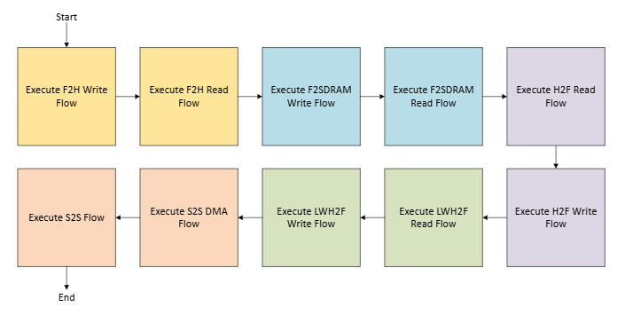
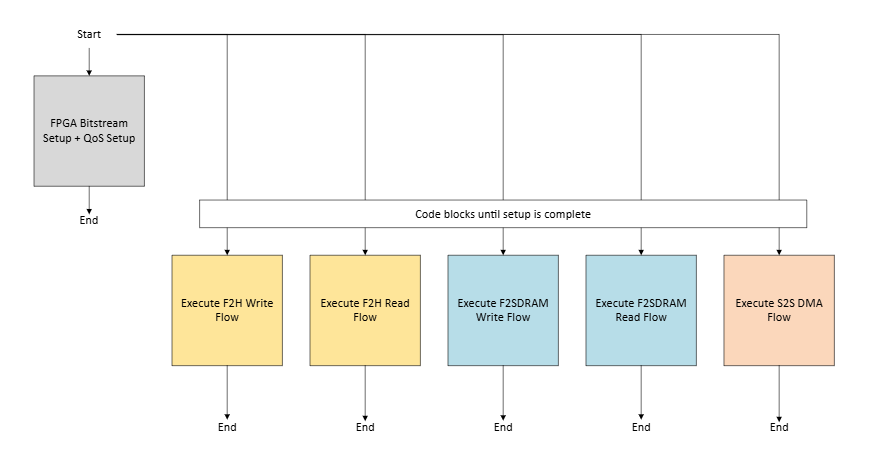

# Data Mover FreeRTOS Software Programs

Data Mover FreeRTOS software programs run on the Agilex 5 HPS and orchestrate data transactions between FPGA fabric and external SDRAM and provide a framework for benchmarking memory transfer performances.

## Data Flows
There are 6 types of data transactions in this design example. The first four benchmarks involve the four data bridges between the HPS and FPGA fabric while the last two showcase transactions to and from external memory:

- **FPGA-to-HPS (F2H)**: showcases data transactions from fabric to external memory through the F2H bridge. Data undergoes cache-coherent mechanisms in the HPS before arriving at external memory.
- **FPGA-to-SDRAM (F2SDRAM)**: showcases data transactions from fabric to external memory through the F2SDRAM bridge. Data transfers occur directly between fabric and external memory, bypassing the HPS.
- **HPS-to-FPGA (H2F)**: showcases data transactions from external memory to fabric through the H2F bridge, facilitated by the Synopsys AXI Direct Memory Access Controllers (DMACs) in the HPS. 
- **Lightweight HPS-to-FPGA (LWH2F)**: showcases data transactions from external memory to fabric through the LWH2F bridge. The data flow is the exact same as the H2F, except the LWH2F bridge has a maximum data width of 32 bits.
- **SDRAM-to-SDRAM (S2S) DMA**: showcases data transactions between different regions in external memory orchestrated by the Synopsys AXI Direct Memory Access Controllers (DMACs) in the HPS.
- **SDRAM-to-SDRAM (S2S) non-DMA**: showcases data transactions between different regions in external memory orchestrated by CPU read/write accesses.

## Transfer Sequences

The FreeRTOS program initiates F2H and F2SDRAM data transactions by configuring mSGDMA IPs in the F2H DMAC subsystem and F2SDRAM DMAC subsystem, respectively. The prefetcher core is enabled in each mSGDMA, using prefetcher linked-lists stored in descriptor On-Chip Memory IPs to automatically fetch the next data block. Details about the mSGDMA programming model can be found in the [Data Mover User Guide](https://altera-fpga.github.io/latest/embedded-designs/agilex-5/e-series/premium-065a/data-mover/ug-data-mover-agx5e-premium-065a/). 

The program initiates H2F, LWH2F, and S2S DMA transactions by configuring the Synopsys AXI DMACs in the Agilex 5 HPS. Notably, the program configures all 4 data channels in each of the 2 DMACs - for a total of 8 data channels - to simultaneously execute data transactions. Similar to the F2H and F2SDRAM tasks, these tasks also use a linked-list stored in program memory to automatically fetch the next data block. Details about the Synopsys DMAC programming model can also be found in the [Data Mover User Guide](https://altera-fpga.github.io/latest/embedded-designs/agilex-5/e-series/premium-065a/data-mover/ug-data-mover-agx5e-premium-065a/).

Below is an overview of each data transfer task performed in this example design. They can be found in the `single-threaded/datamover_tasks` and `multi-threaded/datamover_tasks` folders.

### F2H / F2SDRAM

F2H and F2SDRAM data transactions follow a similar flow that uses the respective fabric-HPS bridge as data path for READ and WRITE operations.

Setup:
1. One 20MB buffer is created in SDRAM. The buffer data is randomized for READ tasks and zeroed for WRITE tasks
2. The mSGDMA read/write descriptor linked-list is created and placed in descriptor On-Chip memory IPs. The linked list is terminated with a null descriptor
3. mSGDMA prefetcher and dispatcher cores are reset and control signals are set
4. Interrupt service routine (ISR) function is registered

For READ Operations (SDRAM -> OCM):
1. Fabric DMA controller reads a 524288-byte data block from source buffer in SDRAM
2. Fabric DMA controller writes the 524288-byte data block to OCM
3. Fabric DMA prefetcher automatically issues new block transfers and repeats Step 1 and 2 for all 524288-byte data blocks in the SDRAM buffer until all data is read to OCM. The last descriptor in the prefetcher list enables interrupts to indicate transfer completion
4. Software loops steps 1-3 for 10 seconds to calculate read bandwidth

See more in the `f2h_read_task.c` and `f2sdram_read_task.c` files.

For WRITE operations (OCM -> SDRAM):
1. Fabric DMA controller reads the 524288-byte data block from OCM
2. Fabric DMA controller writes the 524288-byte data block to destination buffer in SDRAM
3. Fabric DMA controller automatically issues new block transfers and repeats Step 1 and 2 until the SDRAM buffer is full. The last descriptor in the prefetcher list enables interrupts to indicate transfer completion
4. Software loops steps 1-3 for 10 seconds to calculate write bandwidth
  
See more in the `f2h_write_task.c` and `f2sdram_write_task.c` files.

### H2F / LWH2F

H2F and LWH2F data transactions follow the same flow that uses the respective HPS-fabric bridge as data path, but with different sizes of data transfer.

Setup:
1. One 20MB buffer is created in SDRAM. The buffer data is zeroed for READ tasks and randomized for WRITE tasks
2. A linked-list filled with descriptors is created for each DMA channel. Each channel is assigned 1/8th of the 524288-byte block, with the first channel getting the first eighth (0-65535), the second channel getting the second eighth, and so on.
3. All 8 DMA channels are opened and configured

For READ operations (OCM -> SDRAM):
1. HPS DMA controller reads the 524288-byte data block from OCM
2. HPS DMA controller writes the 524288-byte data block to destination buffer in SDRAM
3. HPS DMA controller uses linked-list to automatically issue new block transfers and repeats Step 1 and 2 until the SDRAM buffer is full.
4. Software loops steps 1-3 for 10 seconds to calculate read bandwidth

See more in the `h2f_read_task.c` and `lwh2f_read_task.c` files.

For WRITE operations (SDRAM -> OCM):
1. HPS DMA controller reads a 524288-byte data block from source buffer in SDRAM
2. HPS DMA controller writes the 524288-byte data block to OCM
3. HPS DMA controller uses linked-list to automatically issue new block transfers and repeats Step 1 and 2 for all 524288-byte data blocks in the SDRAM buffer until all data get read to OCM.
4. Software loops steps 1-3 for 10 seconds to calculate write bandwidth

See more in the `h2f_write_task.c` and `lwh2f_write_task.c` files.

### SDRAM to SDRAM

Setup:
1. Two 20MB buffers are created in SDRAM. The source buffer is filled with random data while the destination buffer is zeroed.
2. S2S_DMA follows the same steps as the H2F/LWH2F task to set up DMA controllers.

S2S DMA transactions follow this flow:

1. HPS DMA controller reads a 524288-byte data block from source buffer in SDRAM
2. HPS DMA controller writes the 524288-byte data block to destination buffer in SDRAM
3. HPS DMA controller repeats Step 1 to 2 for all 524288-byte data blocks in a 20MB source buffer until all data get copied to a 20MB destination buffer.
4. Software loops steps 1-3 for 10 seconds to calculate bandwidth

More about this task in `s2s_dma_task.c`

S2S non-DMA transactions involve simple arr_2[i] = arr_1[i] for all i's in two 20MB arr_1 and arr_2 arrays. Source code can be found in `s2s_task.c`

## Program Version and Configurability

This design consists of a single-threaded data transaction demonstration and a multi-threaded data transaction demonstration. The single-threaded program runs each of the 6 different data flows sequentially, allowing for maximum utilization of the HPS-memory DDR4 interface in each case. It showcases the best memory transaction performance results for F2H, F2SDRAM, H2F, LWH2F, and DDR2DDR data flows. The multi-threaded program showcases how to configure QoS generator for different data channels, how to run different data flows concurrently with FreeRTOS multi-threading, and demonstrates performance impact. The example multi-threaded program runs the F2H and S2S non-DMA data flows. Follow comments in multi-threaded/main.c to configure different data flow scenarios.

Below are diagrams describing the single- and multi-threaded program execution order:

Single-threaded:



Multi-threaded:



H2F and LWH2F tasks are currently disabled in the multi-threaded version since the HPS DMA controllers cannot be shared across threads. To enable the H2F and LWH2F tasks, uncomment the code in `multi-threaded/main.c` and ensure H2F, LWH2F, and S2S_DMA do not run at the same time by manipulating the execution barrier.

The table below highlights software configurations that could impact data transaction performance:

<table>
  <thead>
    <tr>
      <th>Program</th>
      <th>Parameter</th>
      <th>Where to Change</th>
    </tr>
  </thead>
  <tbody>
    <tr>
      <td rowspan="3">single-threaded</td>
      <td>transaction duration</td>
      <td>single-threaded/main.c</td>
    </tr>
    <tr>
      <td>memory buffer size (increase by increasing # of transfer blocks)</td>
      <td>single-threaded/datamover_tasks/datamover_tasks.h</td>
    </tr>
    <tr>
      <td>transfer block size (currently set as OCM size which is the max possible value)</td>
      <td>single-threaded/datamover_tasks/datamover_tasks.h</td>
    </tr>
    <tr>
      <td rowspan="5">multi-threaded</td>
      <td>transaction duration</td>
      <td>multi-threaded/main.c</td>
    </tr>
    <tr>
      <td>memory buffer size (increase by increasing # of transfer blocks)</td>
      <td>multi-threaded/datamover_tasks/datamover_tasks.h</td>
    </tr>
    <tr>
      <td>transfer block size (currently set as OCM size which is the max possible value)</td>
      <td>multi-threaded/datamover_tasks/datamover_tasks.h</td>
    </tr>
    <tr>
      <td>QoS generator values*</td>
      <td>multi-threaded/main.c</td>
    </tr>
    <tr>
      <td>Symmetric Multiprocessing (SMP) on/off</td>
      <td>build.sh</td>
    </tr>
  </tbody>
</table>

* Refer to [Data Mover User Guide](https://altera-fpga.github.io/latest/embedded-designs/agilex-5/e-series/premium-065a/data-mover/ug-data-mover-agx5e-premium-065a/) for more details on which QoS generator controls which data path.

# Performance Monitor IPs

On the host machine, a continuously-running PMON TCL program monitors data channel performance metrics in real-time (pmon_read). The program can capture different metrics by specifying different configurations. A detailed list of available metrics can be found in the [Performance Monitor FPGA IP User Guide](https://docs.altera.com/r/docs/817760/25.1.1/performance-monitor-fpga-ip-user-guide-agilextm-3-agilextm-5-and-agilextm-7-fpgas/performance-monitor-pmon-library-functions).

# Build Steps

The expected output of the build process is a JIC file that combines the FPGA bitstream and software binaries that users can program onto the FPGA board with quartus_pgm. The JIC file will contain components laid out in the [QSPI flash PFG file](../qspi_flash_image_agilex5_boot.pfg).

1. Enter the datamover folder

```bash
cd TOP_DIR/dk-a5d064ab32bea-enablement/datamover
```

2. Generate JIC file (XX-datamover.hps.jic)

```bash
make software-freertos_app_qspi-build-sw
```

st-datamover.hps.jic (single-threaded version) and mt-datamover.hps.jic (multi-threaded version) should appear under the software/freertos/datamover-app directory

Note: if you want to build just one of single-threaded or multi-threaded version, run

```bash
./software/freertos/datamover-app/build.sh $VERSION_NAME
```

where $VERSION_NAME is either "single-threaded" or "multi-threaded" or

```bash
make software-freertos_app_qspi-build-XX-sw
```

where XX is either "st" or "mt".

3. Program the board with JIC file

```bash
quartus_pgm -m jtag -c 1 -o "pvi;XX-datamover.hps.jic@2"
```

(Refer to the [Quartus Programmer Guide](https://docs.altera.com/r/docs/683039/current) for more details on quartus_pgm options)

4. Power Cycle the FPGA board
5. Program outputs can be viewed through Serial Terminal Connection

# (Optional) Viewing Performance Monitor Outputs

You can view PMON Outputs in real-time by opening a separate System Console terminal. To ensure that the PMON has enough time to set up after the Data Mover design is loaded onto the board, we recommend setting longer transaction duration for data transaction tasks
(eg. 30 seconds each).

1. Open a separate terminal
2. Enter the datamover directory

```bash
cd TOP_DIR/dk-a5d064ab32bea-enablement/datamover
```

3. Open a System Console terminal

```bash
system-console --cli
```

4. Ensure that power cycle (Step 4 in Build Steps) completes
5. Run the PMON script inside System Console

```bash
source pmon/datamover_pmon.tcl
```

Note: PMON access is only available after FPGA bitstream configuration. Otherwise you might see the following error message:

```bash
Error : Performance Monitor remote JTAG interface not found
Ensure .sof is loaded and JTAG access is functional before loading Performance Monitor System console library
PMON Library loaded
invalid command name "pmon_discover_all"
    while executing
"pmon_discover_all"
```

In such scenario, close system-console, power cycle the board again, and give a bit more time before starting System Console and executing the PMON script again.