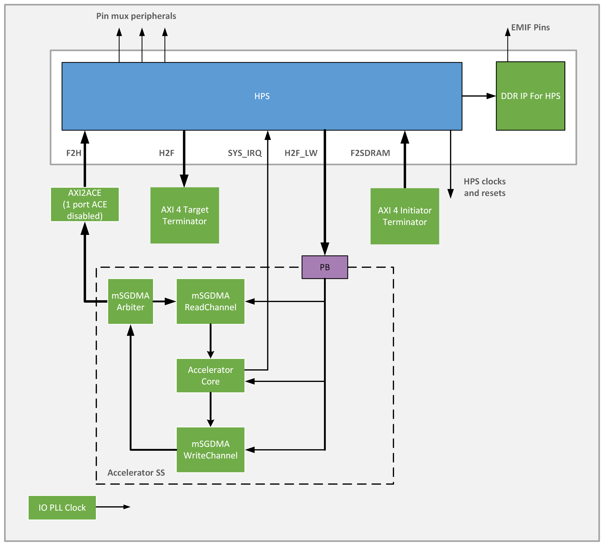

# Cache Coherent Accelerator Example Design for Agilex 5 FPGA E-Series 065A Premium Development Kit

Cache Coherent Accelerator Example Design for Agilex 5 FPGA E-Series 065A Premium Development Kit with Out of Box Experience (OOBE) daughter card, which is also known as HPS Enablement Expansion Board.

## Description

<p>The Cache Coherent Accelerator (CCA) design example is based on the Baseline Hardware Reference Design for Agilex 5 FPGA E-Series 065A Premium Development Kit. It demonstrates a hardware accelerator in the FPGA fabric that communicates with the HPS over a cache-coherent F2H AXI interface, performing bulk read/modify/write operations on HPS DRAM.

</p><p>The design uses HPS First configuration mode and boots from Arm Cortex-A55 core processor.

</p><h2>Cache Coherent Accelerator feature
</h2><p>This design demonstrates the following system integration between Hard Processor System (HPS) and FPGA IPs:
<ul><li>Hard Processor System (HPS) enablement and configuration
<ul><li>F2H AXI bridge configured for cache-coherent access via SMMU
</li><li>HPS Peripheral and I/O (SD/MMC, EMAC, MDIO, USB, I3C, JTAG, UART, and GPIO)
</li><li>HPS Clock and Reset
</li><li>HPS FPGA Bridge and Interrupt
</li></ul></li><li>HPS EMIF configuration
</li><li>System integration with FPGA IPs:
<ul><li>Cache Coherent Accelerator (CCA) core that performs pipelined read/modify/write operations on HPS DRAM over the F2H coherent bridge
</li><li>Modular Scatter-Gather DMA (MSGDMA) read and write channels in prefetcher mode for bulk data movement between FPGA fabric and HPS memory
</li><li>Custom CSR block for accelerator control and status, accessible from the NiosV subsystem
</li><li>On-Chip Memory for DMA descriptor storage and local scratch buffering
</li></ul></li></ul></p>

## Project Details

- **Family**: Agilex 5 E-Series
- **Quartus Version**: 26.3
- **Development Kit**: Agilex 5 FPGA E-Series 065A Premium Development Kit DK-A5E065AB32AEA
- **Device Part**: A5ED065AB32AE1V
- **Category**: HPS
- **Source**: Quartus Prime Pro
- **URL**: https://github.com/altera-fpga/agilex5-ed-hps-fpga-bridges
- **Design Package**: dk-a5e065ab32aea-enablement-cache_coh_accel.zip
- **Documentations**: https://altera-fpga.github.io/latest/embedded-designs/agilex-5/e-series/premium/gsrd/ug-gsrd-agx5e-premium/

## Documentations

- **Title**: Cache Coherent Accelerator Documentation for the Agilex 5 E-Series Premium Development Kit
**URL**: https://altera-fpga.github.io/latest/embedded-designs/agilex-5/e-series/premium/gsrd/ug-gsrd-agx5e-premium/
## Software projects

| Project | Description |
|---------|-------------|
| [FreeRTOS](software/freertos/README.md) | FreeRTOS benchmark application (QSPI boot) |
| [Yocto Linux](software/yocto_linux/README.md) | Linux BSP build, boot, and Simics bring-up |


## Cache Coherent Accelerator Overview

Proceeding parts of this document will highlight the most crucial components of the Cache Coherent Accelerator design.



## HPS IP

The HPS controls all data transaction functionalities, including DMA operations, EMIF data transfer, and the general execution of the application. In this design, the F2H bridge MMU port setting is enabled so that F2H transactions go through the SMMU for cache-coherent transactions. All other parameters are the same as the HPS IP in the baseline-a55 design.

## Modular Scatter-Gather DMA (MSGDMA) IP and AvMM-to-AXI4 Bridge 

The design uses msgDMA IPs in prefetcher mode to facilitate bulk data movement between FPGA fabric and HPS DRAM over the F2H bridge. The prefetcher reads linked descriptor lists stored in on-chip memory, enabling chained multi-block transfers without software intervention between blocks.

One AvMM-to-AXI4 Bridge block combines the AvMM write channel of the Write msgDMA and the AvMM read channel of the Read msgDMA into one single AXI channel interfacing the fabric-to-HPS bridge.

## On-Chip Memory II IP

On-chip memory in the fabric is used for msgDMA descriptor storage and serves as a local scratch buffer during transfer setup. It is configured as dual-port RAM, being accessible from both the HPS subsystem (via H2F_LW Bridge) and the msgDMA's prefetchers.

## Cache Coherent Accelerator (CCA) Core

The CCA core (`src/cca_accel_core.sv`) implements a pipelined read/modify/write engine that fetches data from HPS DRAM, processes it in the FPGA fabric, and writes results back over the F2H coherent AXI bridge. A custom CSR block (`src/cca_accel_csr.sv`) exposes control and status registers for software configuration and step-by-step execution tracking.


## Hardware build

**Prerequisites**
- Altera Quartus Prime 26.3
- Python 3.11.5 (only required when using command line to build)

### Using Quartus GUI
1. Launch Quartus Prime 26.3.
2. Open the design project. E.g `top.qpf`.
3. Click the play button to compile the design.
4. The compiled sof can be found in `output_files/` folder of the project path.

### Using Command Line
1. Build the design sof
```bash
make cache_coh_accel-build
```
After build, the bitstream (sof) can be found in `output_files/` folder.

2. Use the following command to generate the core.rbf (optional)
```bash
make cache_coh_accel-install-core-rbf
```
The generated core.rbf can be found in `install/binaries/` folder.

## Simulation

Follow the steps below to simulate the design using the testbench located in the design sim folder:

1. Ensure Quartus tools are on `PATH`:
```bash
export QUARTUS_ROOTDIR=/path/to/intelFPGA_pro/26.3/quartus
export PATH="$QUARTUS_ROOTDIR/bin:$QUARTUS_ROOTDIR/../qsys/bin:$PATH"
quartus_sh -v
```

2. Prepare simulation scripts.
   In the current project directory, run the following command to generate the necessary simulation scripts from Quartus:
```bash
make prep
```
This runs `quartus_ipgenerate` and `ip-setup-simulation` to generate the `sim_setup_cache_coh_accel` directory with correct file lists.

3. Run the Simulation.
   Navigate to the sim directory:
```bash
cd sim
```
   Depending on your simulator, execute the appropriate shell script to start the simulation. For example:
   For VCS (3-step) simulator,
```bash
./runvcs.sh
```
   For QuestaSim and Questa FE simulator,
```bash
./runquesta.sh
```
   For Xcelium simulator,
```bash
./runxcelium.sh
```

# Yocto Build Setup Guide
1. Refer to [Yocto Linux Build Instructions](software/yocto_linux/README.md#yocto-build) file and follow the steps to build Yocto.

After build, the binaries can be found in the `software/yocto_linux_sd` or `software/yocto_linux_qspi` folder.

# HPS Debug Program
Refer to the [README](software/hps_debug/README.md) file and follow the steps to build the HPS content wipe program.

# FreeRTOS Build Setup Guide
1. Refer to [FreeRTOS Build Instructions](software/freertos/README.md) file and follow the steps to build FreeRTOS.

After build, the JIC file used to program the board can be found in the `software/freertos/project_name` folder.